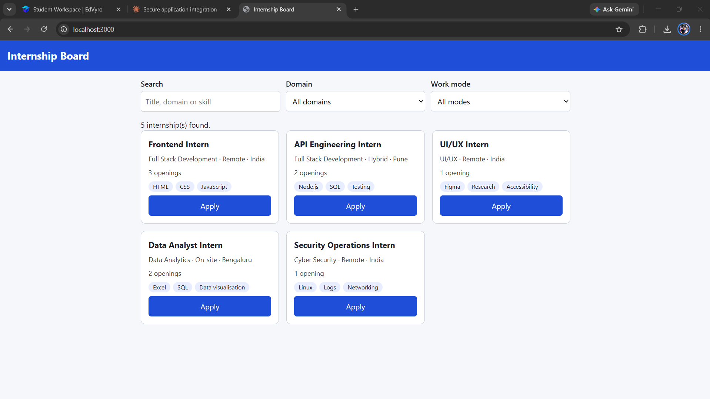
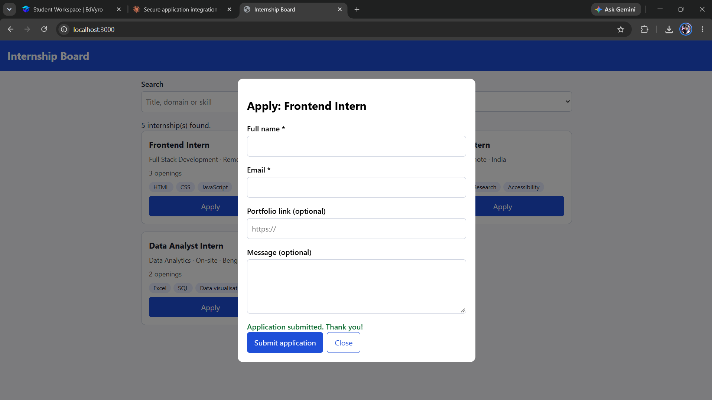
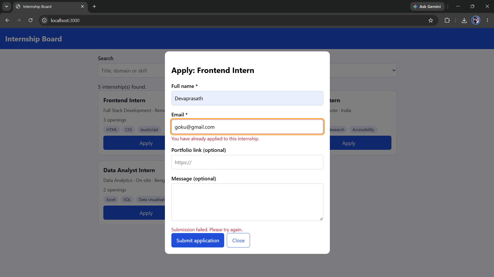
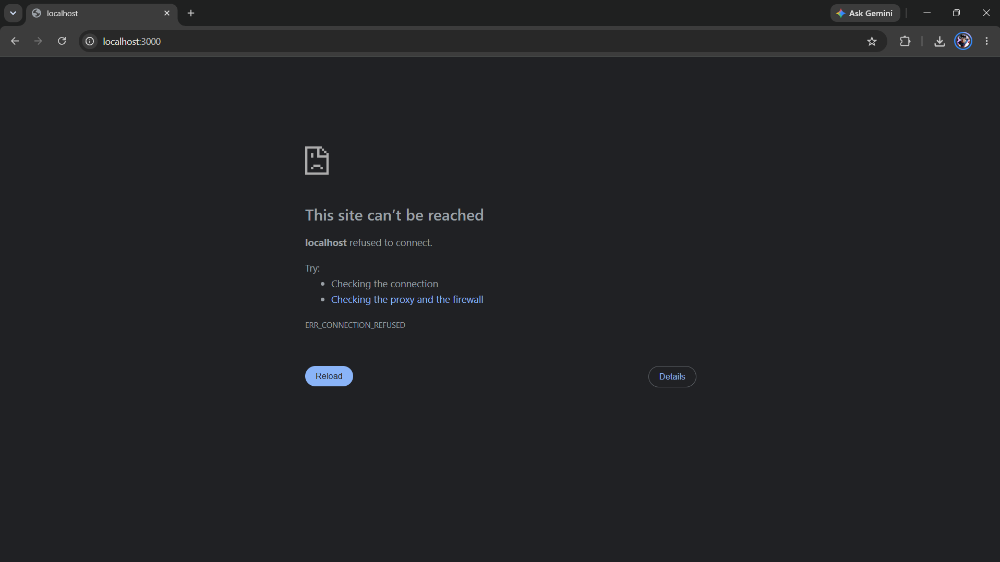

# Internship Portal

A full-stack student internship board. Students can search and filter internships by domain and work mode, view details, and submit an application. Built with a vanilla HTML/CSS/JS frontend served by an Express + SQLite API.



## Live demo
- **App:** _add deployed URL here_
- **Health check:** _add deployed URL_/health
- **2-minute walkthrough:** _add video link here_

## Features
- Internship list loaded from the API with loading skeletons, empty state, error state and **Retry**
- Search plus domain and work-mode filters (keyboard operable, labelled)
- Accessible application dialog with client **and** server validation
- Responsive layout that works at 360px without horizontal scrolling
- Security: rate limiting, Helmet headers, parameterized SQL, duplicate protection
- Operations: `/health` endpoint and structured request logging
- 13 automated tests covering successful and rejected submissions

## Architecture
```
Browser (public/: HTML, CSS, JS)
        |  fetch JSON
        v
Express app (app.js): logging -> helmet -> JSON parser -> rate limits -> routes -> error handler
        |  bound SQL parameters
        v
SQLite (better-sqlite3, data/*.db)
```
| File | Role |
|---|---|
| `server.js` | Opens the database, seeds it, starts the server |
| `app.js` | Express app: middleware, routes, error handling |
| `db.js` | Database connection, schema and idempotent seed |
| `validate.js` | Server-side validation of application data |
| `test/` | Automated tests (node:test + supertest) |

## Engineering decisions
- **Server is the source of truth.** Every field is re-validated on the server even though the form validates too, because client checks can be bypassed.
- **SQLite for persistence.** Zero-setup, file-based and enough for this scope. A multi-server production deployment would move to PostgreSQL.
- **Consistent response envelope** (`status`, `data`, `pagination`, `errors`) so the frontend handles every response the same way.
- **Parameterized queries only.** User input is never concatenated into SQL; a test confirms an injection string is treated as plain text.
- **Layered rate limits.** 100 requests per 15 minutes on the API, and a stricter 10 per 15 minutes on application submissions.
- **Privacy-safe logging.** Logs record method, path, status and duration only. They never contain request bodies, so applicant data cannot leak.
- **Strict Content Security Policy** from Helmet, which is why all JS and CSS live in separate files rather than inline.
- **Idempotent seeding.** The seed runs on every start and keeps existing records and IDs, so deploys and restarts are safe.

## Setup
Requires Node.js 18 or newer.
```bash
npm install
cp .env.example .env     # optional; defaults work (on Windows: copy .env.example .env)
npm run seed             # creates the DB and loads INT-101..INT-105 (also runs on start)
npm start                # http://localhost:3000
npm test
```
Environment variables are listed in `.env.example` (no secrets are committed). The `PORT` variable sets the server port and defaults to 3000.

## API
Envelope: `{ "status": "success" | "error", "data": ..., "pagination": {...}, "errors": [{field?, message}] }`

| Method | Path | Notes |
|---|---|---|
| GET | `/health` | `{ status, uptime, db }`; returns 503 if the database is unreachable |
| GET | `/api/internships?q=&domain=&mode=&page=&limit=` | paginated list |
| GET | `/api/internships/:id` | single record |
| POST | `/api/applications` | `{ internshipId, name, email, portfolioUrl?, message? }` returns 201 / 400 / 404 / 409 / 429 |

Example:
```bash
curl -X POST http://localhost:3000/api/applications \
  -H "Content-Type: application/json" \
  -d '{"internshipId":"INT-101","name":"Asha","email":"asha@example.com"}'
```

## Logging
Each request prints one JSON line and sets an `X-Request-Id` response header:
```json
{"time":"2026-11-11T15:39:50.489Z","id":"7228fd16-...","method":"GET","path":"/api/internships","status":200,"ms":8}
```
Request bodies, emails and names are never logged.

## Quality evidence
| Check | Result | Evidence |
|---|---|---|
| Regression tests | 13 of 13 passing | [docs/test-report.md](docs/test-report.md) |
| Dependency audit | `npm audit`: 0 vulnerabilities | [docs/security-checklist.md](docs/security-checklist.md) |
| Security checklist | All controls passing | [SECURITY.md](SECURITY.md), [docs/security-checklist.md](docs/security-checklist.md) |
| Lighthouse (mobile) | Performance 80, Accessibility 100, Best Practices 100, SEO 90 | `screenshots/lighthouse-before.png` |
| Keyboard operation | Search, filters, cards and dialog operable by keyboard | manual test |
| 360px layout | No horizontal scrolling | `screenshots/mobile.png` |

## Known limitations and next steps
- No authentication; this is a public application form.
- Performance (80) could improve with response compression and static-file caching.
- Move to PostgreSQL for multi-instance deployment.

## Screenshots




