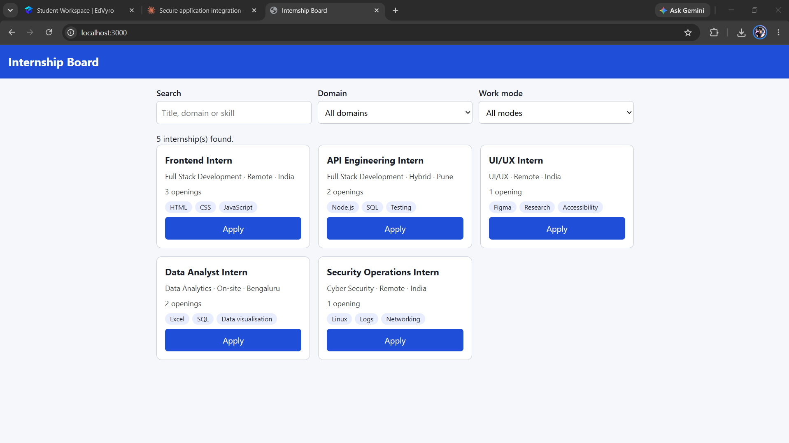
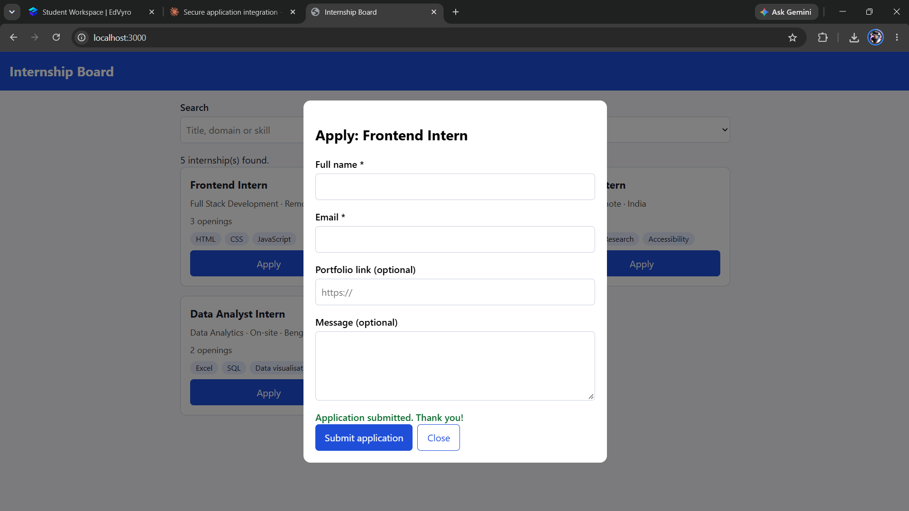
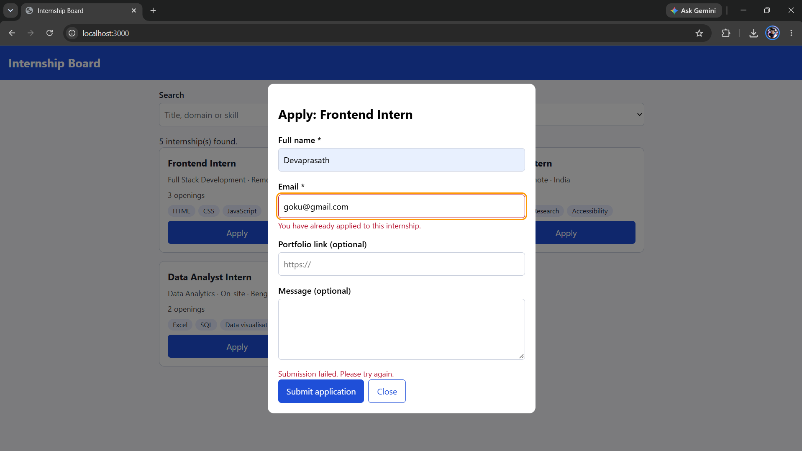
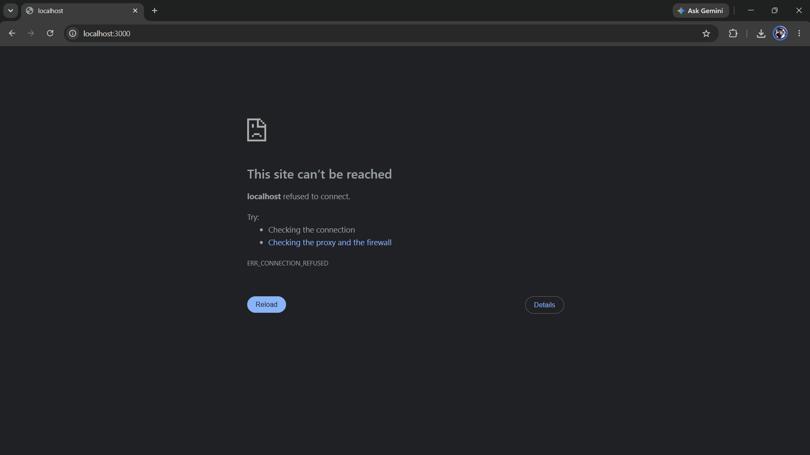

# Internship Portal – Secure Application Integration

Full-stack internship board: vanilla HTML/CSS/JS frontend served by an Express + SQLite API.

## Features
- Internship list loaded from the API with loading skeletons, empty state, error state and **Retry**
- Search + domain + work-mode filters (keyboard operable, labelled)
- Accessible application dialog with client **and** server validation
- Rate limiting, Helmet security headers, parameterized SQL, duplicate protection
- Automated tests for successful and rejected submissions

## Setup
```bash
npm install
cp .env.example .env     # optional; defaults work
npm run seed             # creates the DB and loads INT-101..INT-105 (also runs on start)
npm start                # http://localhost:3000
npm test
```

## API
Envelope: `{ "status": "success" | "error", "data": ..., "pagination": {...}, "errors": [{field?, message}] }`

| Method | Path | Notes |
|---|---|---|
| GET | `/api/internships?q=&domain=&mode=&page=&limit=` | paginated list |
| GET | `/api/internships/:id` | single record |
| POST | `/api/applications` | `{ internshipId, name, email, portfolioUrl?, message? }` → 201 / 400 / 404 / 409 / 429 |

Example:
```bash
curl -X POST localhost:3000/api/applications -H 'Content-Type: application/json' \
  -d '{"internshipId":"INT-101","name":"Asha","email":"asha@example.com"}'
```

## Test report
`npm test` (node:test + supertest, in-memory SQLite):
```
# tests 13
# pass 13
# fail 0
```
Covers: valid/optional-field submissions (201), missing name, bad email, unsafe URLs, unknown internship (404), duplicates (409), malformed/oversized body, SQL-injection string, secure headers, rate limit (429).

## Short explanation
The server is the source of truth: every field is re-validated server-side, SQL uses bound parameters only, writes are rate limited, and Helmet sets secure headers (the strict CSP is why all JS/CSS live in separate files). See [SECURITY.md](SECURITY.md) for the full checklist.


## Screenshots




